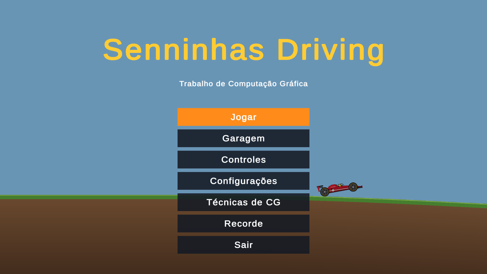
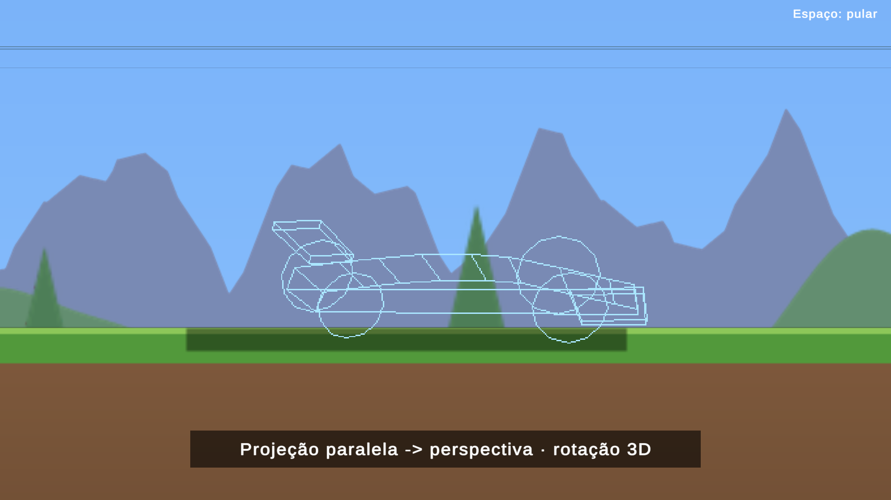
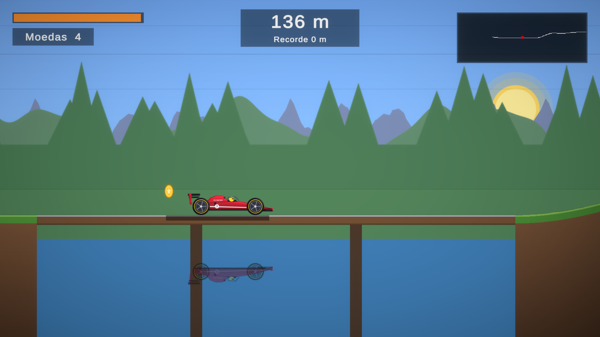
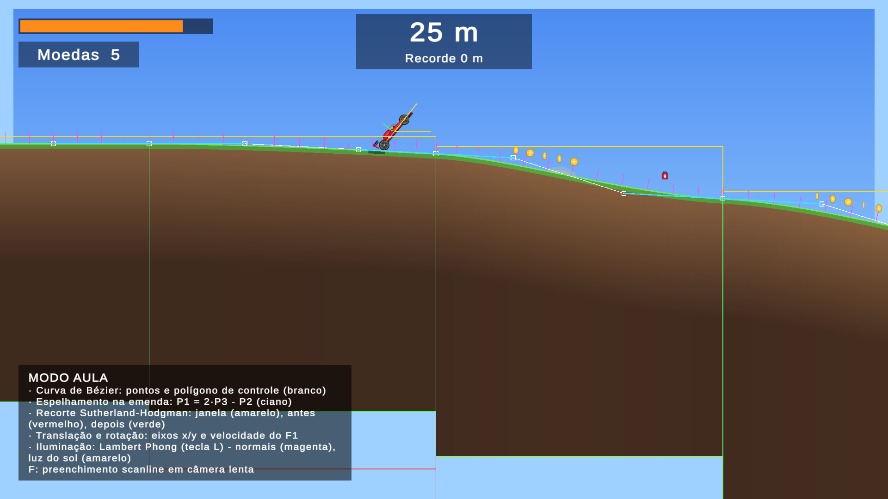
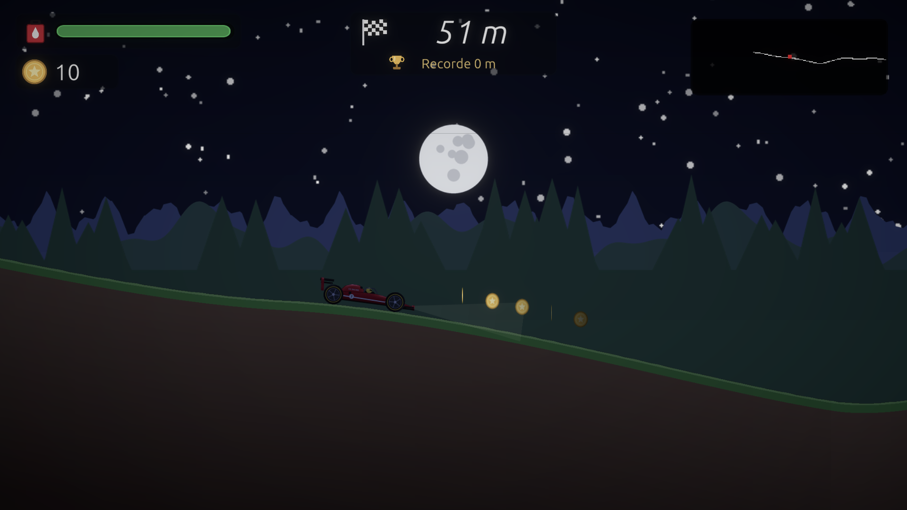

# Senninhas Driving

Jogo 2D estilo *Hill Climb* com um carro de Fórmula 1, feito como **trabalho final de Computação Gráfica**.
Cada técnica da disciplina é **código próprio** e aparece de verdade dentro do jogo: curvas de Bézier, rasterização
(Bresenham), preenchimento (scanline), recorte (Sutherland–Hodgman e Cohen–Sutherland), translação, rotação,
espelhamento, iluminação/sombreamento (Flat, Gouraud, Phong) e projeções paralela e perspectiva.



---

## Como jogar

### 1. Baixar e abrir (Linux)

1. Vá em **[Releases](../../releases)** e baixe `SenninhasDriving-linux.tar.gz`.
2. Extraia e rode:
   ```bash
   tar -xzf SenninhasDriving-linux.tar.gz
   cd SenninhasDriving
   ./SenninhasDriving.x86_64
   ```
   (Ou dois cliques no arquivo `SenninhasDriving.x86_64`. Se não abrir: botão direito → Propriedades →
   "Permitir executar como programa".)
3. O jogo abre em **tela cheia**. Para sair: botão **Sair** no menu ou **Alt+F4**.

> Mantenha a pasta inteira junta: o executável precisa de `SenninhasDriving_Data/`, `UnityPlayer.so` e `libdecor-*`.

### 2. Objetivo

Dirija o mais longe possível pelo terreno infinito. Pegue **moedas** e **galões de combustível** (a barra no canto
superior esquerdo vai de verde a vermelho). O jogo termina quando o carro **capota** (capacete no chão) ou quando
acaba o combustível e o carro para. Quando a gasolina acaba, dá para continuar **no embalo** enquanto o carro andar.
O recorde de cada modo fica salvo.

### 3. Controles

| Tecla | Ação |
|---|---|
| **→** | acelera |
| **←** | freia / ré |
| **→ / ← no ar** | gira o carro (cuidado para não capotar!) |
| **Espaço** | pula a intro |
| **Esc** | pausa |
| **R** | reinicia |
| **Tab** | **modo aula** (mostra as técnicas de CG por cima do jogo) |
| **F** | no modo aula: congela e repinta o trecho por *scanline* em câmera lenta |
| **L** | troca o sombreamento do terreno: Flat → Gouraud → Phong |
| **P** | troca a projeção do fundo: perspectiva ↔ paralela |

No menu dá para usar o mouse ou as setas + Enter.

### 4. Modos e menu

- **Terra**: gravidade normal, ciclo dia/noite (~3 min), lagos com ponte e reflexo.
- **Lua**: gravidade baixa ("bugada", o carro voa longe), céu preto com a Terra, luz fixa e sombra dura.
- **Garagem**: escolha a cor do F1.
- **Configurações**: qualidade (resolução do terreno), **volume**, tela cheia e "modo aula ao iniciar".
- **Técnicas de CG**: lista de todas as técnicas e onde cada uma aparece no jogo.
- **Recorde**: melhor distância e moedas de cada modo.

### 5. O que observar enquanto joga

| | |
|---|---|
|  | **Intro (só na 1ª partida):** F1 3D em wireframe girando, projeção paralela → perspectiva, contorno por Bresenham, preenchimento por scanline e passagem para a arte HD. |
|  | **Lago:** a cada 8–12 trechos, ponte sobre a água com o F1 refletido (y' = 2h − y) e recortado contra a água. |
|  | **Modo aula (Tab):** pontos de controle da Bézier, emenda espelhada, janela de recorte, normais, vetor do sol, eixos do carro, janela do minimapa. |
|  | **Dia/noite:** sol e lua em arco, estrelas, faróis e lanterna do F1, sombra projetada. |

---

## Técnicas de Computação Gráfica (onde estão)

| Técnica | Onde aparece no jogo | Código |
|---|---|---|
| Curva de Bézier | Terreno infinito de Bézier cúbicas | `TerrenoGerador`, `Raster.BezierPoint` |
| Espelhamento | Emenda C1 entre trechos (P1 = 2·P3 − P2); reflexo do F1 no lago | `Raster.BezierJoin`, `Raster.Refletir`, `Reflexo` |
| Recorte | Sutherland–Hodgman no terreno e no reflexo (com UV); Cohen–Sutherland no minimapa e na intro | `Raster.ClipPolygon`, `Raster.ClipLine`, `ReflexoGeometria` |
| Preenchimento | Scanline do terreno (tecla F), da sombra e das regiões do F1 na intro | `Raster.ScanlineSpans`, `TerrenoChunk`, `IntroDesenho` |
| Rasterização | Bresenham no wireframe e contorno da intro e no minimapa | `Raster.Line`, `IntroDesenho`, `MinimapaDesenho` |
| Iluminação e sombreamento | Lambert Flat/Gouraud/Phong no terreno (L), shader Phong do F1 com normal map, sombra projetada | `Sombreamento`, `Shaders/F1Phong.shader`, `Sombra` |
| Projeções | Intro: matrizes 4×4 paralela → perspectiva; fundo em 3 camadas com parallax por perspectiva (P) | `Projecao`, `ModeloF1`, `Parallax` |
| Translação e rotação | Carro, rodas, giro no ar, moedas sobre a curva, rotação 3D (Ry·Rx) da intro | `F1`, `Coletaveis`, `ModeloF1.Rotacao` |
| Janela → viewport | Minimapa e buffer da intro | `Raster.JanelaViewport` |

Os algoritmos ficam em `CarroCG/Assets/Scripts/Raster.cs` e `CarroCG/Assets/Scripts/Jogo/`. São funções puras,
cobertas por testes automáticos (`CarroCG/Assets/Tests/`).

---

## Rodar pelo código-fonte

- **Unity 6000.3.25f1** (Unity 6) com URP 2D; módulo *Linux Build Support* para gerar o executável.
- Abra a pasta `CarroCG` no Unity Hub → cena `Assets/Scenes/Menu.unity` → **Play**
  (dica: na aba Game, "Play Maximized").

As cenas são montadas por scripts de Editor (menu **CarroCG → Montar Jogo / Montar Menu**). Ferramentas de linha de
comando (com o Editor fechado):

| Script | O que faz |
|---|---|
| `Tools/rodar_testes.sh [EditMode\|PlayMode]` | roda os testes automáticos |
| `Tools/montar_cenas.sh` | remonta as cenas Jogo e Menu |
| `Tools/capturar.sh` | joga sozinho e salva capturas em `previews/` |
| `Tools/gerar_executavel.sh` | gera o executável Linux em `Build/` |
| `python3 Tools/gerar_f1.py CarroCG/Assets/Art` | gera toda a arte (F1, céu, fundo, ícones, logo) e o contorno da intro |
| `python3 Tools/gerar_guia.py` | gera o `Guia para apresentação.pdf` (precisa de `reportlab`) |

### Estrutura

```
CarroCG/                 projeto Unity
  Assets/Scripts/        Raster.cs (algoritmos) e Jogo/ (terreno, F1, luz, projeções, intro, lago, som, efeitos)
  Assets/Shaders/        F1Phong e TerrenoLuz (HLSL)
  Assets/Editor/         montagem das cenas e geração do executável
  Assets/Tests/          testes EditMode e PlayMode
  Assets/Art/            arte gerada (F1, céu, fundo, UI) e fontes Ubuntu
Tools/                   scripts (testes, cenas, capturas, arte, guia, executável)
docs/superpowers/        especificações e planos de cada etapa
previews/                capturas automáticas
Guia para apresentação.pdf
```

---

## Tecnologias e créditos

- **C#** na Unity 6 (URP 2D): jogo, algoritmos e testes · **HLSL**: shaders próprios · **Python + Pillow**: arte.
- Arte do F1, céu, fundo, ícones e logo **gerada por código** (`Tools/gerar_f1.py`); sons **sintetizados em C#**
  (`SomSintetizado`).
- Fonte **Ubuntu** (Ubuntu Font Licence, cópia em `CarroCG/Assets/Art/UI/`).
- Tiles do vídeo antigo (`Main.unity`): Kenney Pixel Platformer (CC0).
